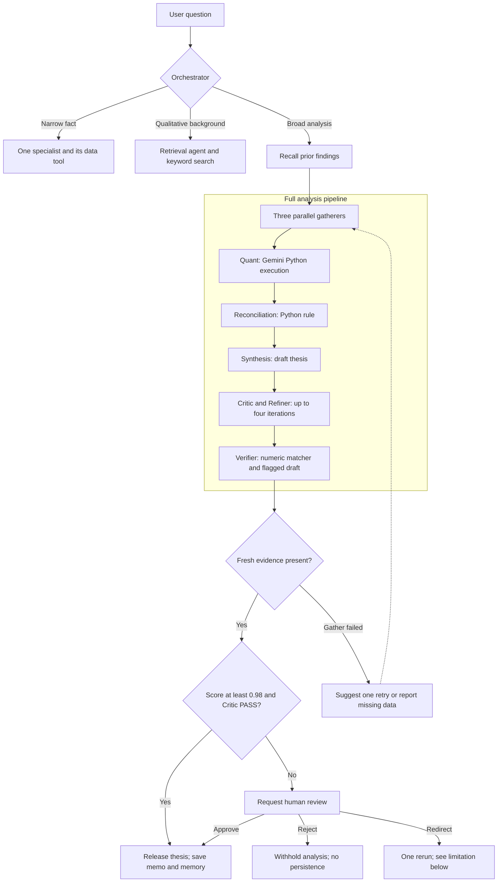

# ARGUS

**A**utonomous **R**easoning & **G**rounded **U**nderstanding **S**ystem


> A multi-agent research prototype combining executed financial calculations, adversarial review,
> and deterministic numeric checks.

Ask ARGUS about a company. An Orchestrator chooses a single specialist, optional background
retrieval, or a full research pipeline. The full path gathers three sources in parallel, executes
Python for derived financial metrics, checks headline tone against profitability, drafts and
critiques a thesis, then checks its numeric values before a release decision.

Built with Google's [Agent Development Kit](https://google.github.io/adk-docs/) (ADK), pinned to
**2.5.0**. The application and sample data run on your machine; **model inference and built-in code
execution use the hosted Gemini API**. This is not an offline model or local Python sandbox.
Development used free-tier access; current model availability and quotas depend on your account.

Only **Acme Corp** and **Globex** exist in the bundled dataset. They are fictional companies with
sample filings, pre-labelled news, and historical monthly prices, not live financial feeds.


https://github.com/user-attachments/assets/14850945-2dd0-4d36-98d8-d0d434d39a92


*Narrow questions use a single specialist; broad due-diligence requests use the complete pipeline
below. Narrow and retrieval routes bypass its review loop, verifier, and human gate.*

## The problem and approach

A fluent answer can contain bad arithmetic, unsupported conclusions, or optimistic framing that
ignores losses. ARGUS separates those concerns into components with explicit inputs and outputs:

| Concern | Implementation | Practical limit |
|---|---|---|
| Arithmetic | Quant is instructed to execute Python for growth, margins, CAGR, debt change, and volatility | The model still generates the code and narrates its result |
| Narrative versus profitability | A Python rule compares a headline's sentiment label with the sign of the named year's net income | This detects a tension, not whether a headline is factually false |
| Unsupported reasoning | Critic/Refiner loop reviews and revises a draft against evidence | LLM review remains probabilistic |
| Numeric fabrication | Python extracts numeric literals from the draft and value-matches against evidence and Quant output | No binding to metric, unit, company, or year |
| Release decision | Python checks the numeric score and Critic verdict; a long-running tool supports human review | The Orchestrator must call the checks in the instructed sequence |
| Evidence of quality | Offline tests, eight golden scenarios, and a six-run ablation experiment | Small historical sample, not a production reliability benchmark |

The design principle is **use code for calculations and checks that code can decide; use the LLM
for interpretation, tool selection, and writing**. It reduces specific failure modes rather than
guaranteeing that every answer is correct.

## How a request moves through the system



1. **Route.** `argus/agent.py` exposes `orchestrator_agent` as `root_agent`. Its LLM chooses among
   specialists or the whole pipeline, each exposed as an `AgentTool`. Ambiguous analysis requests
   are instructed to take the broad path.
2. **Gather.** Three specialists call `get_filings`, `get_market_data`, and `get_news` concurrently.
   They are instructed to return tool JSON verbatim. Each writes a separate evidence key and
   freshness stamp so parallel branches avoid write collisions.
3. **Compute.** Quant reads filings and prices through a callable instruction and uses
   `BuiltInCodeExecutor`. It requests YoY revenue growth, yearly net margins, revenue CAGR,
   first-to-last debt change, and standard deviation of monthly percentage returns.
4. **Reconcile.** A custom `BaseAgent` calls `find_contradictions` in Python and bundles evidence
   plus detected narrative-profitability tensions. It makes no LLM call.
5. **Draft.** Synthesis uses the evidence bundle and Quant output to write trends, price behavior,
   catalysts, and a confidence label. It is instructed to use supported numbers and to treat the
   user's assertions as instructions, never as evidence.
6. **Review.** Critic checks the draft against raw evidence and computed metrics. It can call
   `exit_loop` and record `PASS`; otherwise Refiner rewrites the draft. `max_iterations=4` bounds
   the loop even when the model forgets its exit tool.
7. **Check numbers.** Verifier calls `check_grounding`, which extracts numbers directly from the
   draft, matches values, and writes `meta.groundedness`. The Verifier LLM then applies
   `[UNVERIFIED: ...]` flags and replaces the draft.
8. **Decide release.** Back at Orchestrator level, `check_gather_status` checks evidence and request
   stamps. A failure can suggest one corrected-name retry. `evaluate_gate` auto-approves when the
   numeric score is at least **0.98** and the Critic recorded a clean `PASS`; otherwise the
   Orchestrator is instructed to invoke the human-review tool.
9. **Persist approved work.** The Orchestrator is instructed to present the thesis verbatim and
   call `remember_finding` and `save_memo`. Both tools refuse writes unless `meta.human` records
   `approve` or `auto_approved`.

Workflow order is deterministic; LLM outputs and tool selection are not. `SequentialAgent`,
`ParallelAgent`, and `LoopAgent` compose the pipeline, while an LLM routes into it. These template
workflows remain the project's pinned implementation; ADK's
[documentation](https://github.com/google/adk-docs/blob/main/docs/agents/workflow-agents/index.md)
now describes newer graph workflows as their successor.

## State, tools, and framework boundaries

Agents exchange data through **`session.state`**, a key/value working store. The constants in
[`argus/state_keys.py`](argus/state_keys.py) standardize names; they do not create a typed evidence
schema. Many values are JSON or prose strings.

| State key | Writer / purpose |
|---|---|
| `evidence.filings`, `evidence.market`, `evidence.sentiment` | Separate parallel gatherer outputs |
| `meta.request_id`, `evidence.*_run_id` | Current-turn identity and evidence freshness |
| `analysis.quant` | Quant's narrated computation output |
| `analysis.reconciled` | Evidence bundle and reconciliation findings |
| `draft.thesis` | Synthesis draft, then sequential Refiner/Verifier replacements |
| `review.critique` | Critic verdict or issues |
| `meta.groundedness`, `meta.human` | Numeric score and release decision |
| `retrieval.context` | Optional background retrieval output |

`output_key` stores an LLM's final text, not a tool's raw return value. Gatherers are therefore
instructed to relay JSON exactly, but this relay still depends on model behavior. Callable
instructions read dotted keys directly instead of relying on ADK string-template substitution.
The custom Reconciliation agent writes state by yielding an `EventActions(state_delta=...)` event.

Source inspection of the installed ADK `AgentTool` explained several design choices:

| Inner agent/tool boundary | Behavior in the pinned implementation |
|---|---|
| Session state | Parent snapshot enters; inner state deltas return to the parent |
| Artifacts | Explicitly forwarded to the parent's artifact service |
| Memory | Inner runner gets a fresh, throwaway in-memory service |
| Long-running human-pause signal | Not forwarded from inner events |
| Streaming configuration | Outer `RunConfig` is not passed to the inner runner |

Consequently, **memory writes and human review live on the outer Orchestrator**. Memo saving also
lives there so approval happens first. The Dev UI's streaming toggle affects Orchestrator calls;
the wrapped pipeline does not inherit it. See [DEVLOG.md](DEVLOG.md) for observed behavior and
[DECISIONS.md](DECISIONS.md) for the design rationale.

## What numeric groundedness means

[`check_grounding`](argus/tools/claim_matcher.py) normalizes the draft and sources, extracts numeric
literals, and compares each distinct draft value against the pooled evidence and Quant values
using a **fixed absolute tolerance of 0.5**. The score is the fraction of distinct extracted values
that match, rounded to four decimals. A draft containing no extracted numbers scores 1.0.

Normalization handles currency commas/signs, ISO and prose dates, quarter references, numeric
ranges, and the specific phrase `loss of $N`. Calendar dates are excluded from the numeric check.

This is **value matching**, not full factual verification or claim-level citation tracing. A correct
`$2.85 billion` restatement of `2850 million` may be rejected; an incorrect `$500M` debt claim may
pass because an unrelated `$500M` credit facility exists in the evidence. Qualitative claims depend
on LLM review. Derived claims are compared partly against Quant's own prose output; only the eval
harness independently recomputes the expected metrics from raw data. The Verifier's subsequent
flagging rewrite and the Orchestrator's presentation are not mechanically rechecked afterward.

The **0.98 threshold is a prototype policy**, chosen between historical clean and adversarial
scores, not a calibrated probability of correctness. Synthesis's low/medium/high confidence label
is a separate LLM judgment.

## A concrete example: Globex

Globex's sample filings show revenue rising from **$2,200M in 2021 to $2,940.7M in 2025**, while net
income falls from **$88M to -$118.2M**. A January 2025 headline calls FY2024 the strongest year in
company history; that year's filed net income is **-$57M**.

The reconciliation rule flags the positive headline label against negative FY2024 net income.
That does not prove the record-revenue statement is false. It gives Synthesis a concrete tension
to explain: revenue growth and deteriorating profitability can coexist.

The computation stage can add CAGR, margins, debt change, and return volatility, which a simple
headline summary does not provide. Current sample numbers and historical generated theses can be
inspected in [`data/`](data/) and the [committed ablation output](eval/results/ablation_2026-08-02.json).

## Guardrails and human review

Four callbacks in [`argus/callbacks/guardrails.py`](argus/callbacks/guardrails.py) handle:

- **Before model:** regex-based refusal of direct trade-advice requests.
- **After model:** stripping selected action-advice/rating patterns and fenced text code blocks.
- **Before tool:** counting calls and blocking calls beyond a budget of 20 in that context's state.
- **After tool:** logging provenance and prefixing warnings on selected embedded-instruction patterns.

Model-bearing agents receive model callbacks; agents with function tools also receive tool
callbacks. These are narrow heuristics, not comprehensive advice detection or prompt-injection
isolation. Flagged source text remains visible. `AgentTool` state snapshots and concurrent branches
mean the tool counter is **not an atomic global API-call, token, or spending cap**.

Human review uses `LongRunningFunctionTool(request_human_approval)`. The tool returns `None`, leaving
its call pending for the Dev UI to resume with the human's answer. Supported replies include:

```json
{"decision": "approve"}
{"decision": "reject", "reason": "The evidence is insufficient."}
{"decision": "redirect", "scope": "Focus on profitability."}
```

Approve releases; reject withholds and prevents persistence. The implemented redirect instruction
allows one rerun and, if it still misses the bar, **presents it with a caveat without a third review**.
That branch is not independently live-verified and does not provide the same release guarantee as
the normal approval path. Persistence still requires an approval in state.

## Getting started

Use **Python 3.12**, the version targeted by the project configuration and CI. From the repo root:

```bash
python -m venv .venv
```

Activate the environment **before installing**:

```powershell
# Windows PowerShell
.\.venv\Scripts\Activate.ps1
```

```bash
# macOS / Linux
source .venv/bin/activate
```

Then install and configure:

```bash
python -m pip install -r requirements.txt
```

Copy [`argus/.env.example`](argus/.env.example) to `argus/.env` and add a Gemini API key from
[Google AI Studio](https://aistudio.google.com/). The file is ignored by Git:

```dotenv
GOOGLE_GENAI_USE_VERTEXAI=FALSE
GOOGLE_API_KEY=your-key-here
```

Start the Dev UI:

```bash
python -m google.adk.cli web --port 8000
```

Open `http://localhost:8000`, select `argus`, and try:

- `What's Acme Corp's recent stock price trend?` — a single specialist over sample prices.
- `Give me a full due-diligence analysis of Globex.` — the full pipeline and planted tension.
- `What's Acme Corp's competitive position?` — optional keyword retrieval over analyst notes.

Historical broad runs used roughly **15–20 model calls**, varying with review iterations, retries,
and tool follow-ups. Rate limits and transient model failures can still abort a run. Configured
models use up to five attempts with exponential backoff; this cannot resolve sustained quota loss.

Model assignments are centralized in [`argus/config.py`](argus/config.py):

| Role | Checked-in model ID |
|---|---|
| Orchestrator, three gatherers, Quant | `gemini-3.5-flash-lite` |
| Critic, Refiner, Verifier | `gemini-3.1-flash-lite` |
| Synthesis | `gemini-3.5-flash` |
| Retrieval | `gemini-2.5-flash` |

These reflect historical availability and quota observations, not a guarantee of access today.
`MODEL_PRO` aliases `MODEL_FLASH`. Check your account's supported models and limits before live runs.

## Tests and CI

```bash
python -m pytest tests/ -v
python -m pip install -r requirements-dev.txt
ruff check argus/ tests/
pyright argus/
```

**156 offline tests** cover matching/normalization, reconciliation, keyword retrieval, approval checks
for persistence, gather freshness/retry status, guardrail patterns/counters, and eval helpers. They
import ADK but make no model calls and need no API key. Passing them does not prove live routing or
human-resume behavior; historical live checks are recorded in [DEVLOG.md](DEVLOG.md).

[GitHub Actions](.github/workflows/tests.yml) runs pytest and a separate Ruff/Pyright job for pushes
and pull requests to `main`. It deliberately does not run live `adk eval` or spend Gemini quota.

## Evaluation and measured results

[`eval/argus_evalset.json`](eval/argus_evalset.json) defines **eight golden scenarios**: three narrow,
one retrieval, and four broad (clean, planted tension, missing company/retry, adversarial injection).
A golden is an expected reference response and tool trajectory, not a guarantee of identical prose.

| Scoring check | What it measures | Threshold |
|---|---|---|
| `tool_names_trajectory` | Expected tool names occur in order; extra calls allowed, arguments ignored | 1.0 |
| `numeric_fidelity` | Response values match independently recomputed raw/derived filing and market values | 0.8 |
| `independent_groundedness` | Recompute score from raw mock evidence and independently derived metrics | 0.9 |
| `contradiction_correctness` | Disclosure heuristic agrees with planted narrative-profitability findings | 1.0 |
| `response_match_score` | Built-in reference-text similarity; a soft wording check | 0.25 |

Four custom metrics live in [`argus/eval/custom_metrics.py`](argus/eval/custom_metrics.py); none uses
an LLM judge. Applicable checks depend on the route. The independent metrics recompute the numeric
reference but share the production parser/matcher, so shared parsing defects remain possible.

Historical runs demonstrated narrow routing, retrieval, clean broad analysis, the planted Globex
tension, and resistance to an injected future-revenue claim. **Missing-company retry remains
variable.** The September 3 live batch initially passed 5/8 cases. Metric fixes and a reference-answer
recalibration projected **8/8 by offline rescoring of those saved responses**; a confirming live
rerun was deferred. Do not present that projection as a fresh live 8/8 result.

Install live-evaluation extras separately:

```bash
python -m pip install -r requirements-eval.txt
```

From the repository root with the key configured:

```bash
python -m google.adk.cli eval argus eval/argus_evalset.json --config_file_path eval/test_config.json --print_detailed_results
python -m argus.eval.ablation
```

Both invoke Gemini. See [reproduction notes](DEVLOG.md#reproducing-the-results) for the historical
NLTK workaround and shell environment setup. Ablation checkpoints completed scenarios to the
ignored `.ablation_checkpoint.json`; existing entries are reused, so use a fresh checkpoint when
measuring changed code or models.

## Ablation study: removing components

The [August 2 experiment](eval/results/ablation_2026-08-02.md) ran three variants on two companies,
once each: **six live runs**, with [raw outputs committed](eval/results/ablation_2026-08-02.json).

| Variant | Acme groundedness | Globex groundedness | Derived metric families present |
|---|---|---|---|
| Baseline | 1.00 | 1.00 | CAGR, YoY growth, margins, volatility |
| No Critic/Refiner | 1.00 | 0.9655 | Same four |
| No Quant (`no_code_exec`) | 1.00 | 1.00 | None |

Removing Quant preserved value-grounding scores but removed the four derived metric families in
these responses. **The entire Quant agent was removed**, not just its executor, so the experiment
measures the computation stage as a whole. The lower `no_critic` score came from a date fragment
(`22`), a parser issue addressed later; it is not strong evidence of better financial reasoning.

The runner invokes pipeline variants directly, bypassing Orchestrator, memory, and the human gate.
Scores come from each run's own numeric matcher; derived-content assessment was manual. With one
run per variant/company, later parser changes, and later model reassignment, these are historical
observations rather than a statistically established benefit or current success-rate benchmark.

## Project structure

```text
argus/
  agent.py                 ADK entry point: root_agent = orchestrator_agent
  config.py                model assignments, retry settings, release threshold
  state_keys.py            shared state-key constants
  agents/                  router, gatherers, Quant, reconciliation, drafting/review, retrieval
  tools/                   mock loaders, matcher, reconciler, retrieval, memory, HITL, memo
  callbacks/               model/tool lifecycle guardrails
  eval/                    custom scoring functions and ablation runner
data/                      two fictional companies and background analyst notes
eval/                      golden scenarios, scoring configuration, historical ablation results
tests/                     156 offline tests
.github/workflows/         pytest + Ruff + Pyright CI
```

Base dependencies are pinned in `requirements.txt`; development and live-evaluation extras are
separate. [DEVLOG.md](DEVLOG.md) records build history; [DECISIONS.md](DECISIONS.md) records rationale.
Private planning and interview notes are intentionally ignored by Git.

## Engineering lessons

- **A clean trace can still hide a broken feature.** A memory write inside `AgentTool` succeeded
  into a throwaway store. Cross-session recall exposed it; source inspection explained why the
  write had to move to the outer Orchestrator.
- **Decide from state, not polished failure prose.** A failed gather still produced a coherent
  low-confidence thesis. `check_gather_status` now inspects evidence directly, including per-turn
  stamps so old evidence cannot count as a new gather.
- **Relative tolerance can validate invented identifiers.** A 1% tolerance around 2025 admitted
  fabricated 2026. Fixed absolute tolerance blocks that adjacent-year case. Date normalization
  must also run on source text, or a day fragment can validate an unrelated small number.
- **Instructions do not enforce persistence policy.** Both saving tools now check approval in code;
  a failed gate writes `pending_review` to replace any prior approval.
- **Evaluation code needs verification too.** A private parser copy drifted behind production;
  a disclosure metric expected “contradiction” after Synthesis had been changed to prefer “tension”.
  Sharing normalization and testing the scoring helpers addressed those failures.

## Status and remaining limits

The local pipeline, routing, review, numeric checking, human approve/reject, memory, artifacts, and
historical evaluation/ablation runs are implemented. A containerized server/UI experiment was later
withdrawn; **there is no deployment implementation or live hosted endpoint in this checkout**.
Cloud deployment and production tracing are future work. Deployment history is not a claim of a
currently deployed Cloud Run or Vertex service.

Remaining limitations:

- **Model-mediated control flow.** Correct retry suggestions and status decisions are Python;
  actually calling the retry, verifier, or gate still depends on the LLM following instructions.
  The retry counter is session-scoped. A deterministic controller is a future improvement.
- **Numeric scope.** Matching is value-only, excludes calendar dates, deduplicates values, and
  accepts no-number text at 1.0. It does not verify qualitative truth, citations, or correct context.
  Independent in-run recomputation and structured metric/unit/year matching remain open.
- **State lifecycle.** Freshness stamps and pending-approval resets have offline regression tests;
  the specific multi-turn stale-state cases still need dedicated live verification.
- **Human redirect.** Implemented with the caveated-release behavior above, not independently
  live-verified. Normal approve/reject paths were documented end to end.
- **Runtime memory.** Cross-session within one process, cleared on restart; keyword retrieval,
  not a durable semantic database. Recall provides continuity, not evidence for a new analysis.
- **Retrieval.** Keyword overlap over a tiny local corpus, no embeddings or vector database.
- **Data and scale.** Mock inputs, regex-based guardrails, small eval coverage, API quota constraints,
  and no production deployment/load-test evidence.

See [DEVLOG.md](DEVLOG.md) and [DECISIONS.md](DECISIONS.md) for the history behind these choices.
